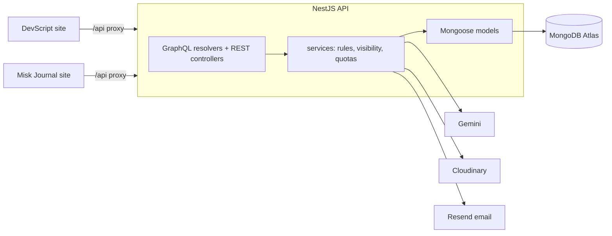

# DevScript API

One NestJS backend for two writing sites: **DevScript** (technical articles, open to any developer) and **The Misk Journal** (poems and reflections, in Bangla and English). Each post belongs to a `space`, and every query is scoped to one, so the two sites never mix.

**Stack:** NestJS 11 · TypeScript · GraphQL (Apollo, code-first) + REST · MongoDB/Mongoose · JWT with rotating refresh tokens · Google Gemini (`@google/genai`) · Cloudinary · Resend email

**Live:** [devscript-seven.vercel.app](https://devscript-seven.vercel.app) · [misk-journal.vercel.app](https://misk-journal.vercel.app) · **Frontend:** [devscript-web](https://github.com/rifah07/devscript-web) (both sites from one Next.js codebase)

▶ **Demos:** [DevScript, 1 min](https://github.com/rifah07/devscript-web/blob/master/docs/demo-devscript.mp4) · [The Misk Journal, 45 s](https://github.com/rifah07/devscript-web/blob/master/docs/demo-misk.mp4)

---

## Why it's interesting

- **Two products, one backend, zero leakage.** Every query is scoped to a `space`; a pen-name site and a real-name site share code but never data or links.
- **Security audited and pinned by tests.** Account takeover via Google linking, login CSRF, email HTML injection and more were found, fixed and locked in by `test/security.e2e-spec.ts`.
- **AI that stays cheap and honest.** Free Gemini models behind per-user quotas, a site-wide budget and an output guardrail; semantic related posts use embeddings plus a top-k heap instead of a vector database.
- **Free to run.** Runs on Vercel, MongoDB Atlas M0, Cloudinary and Resend, all on free plans.

## Architecture



## What it does

| Area | Highlights |
|---|---|
| Writing | Drafts, publish, schedule, series, categories, tags, image galleries with alt text, slugs that never change |
| Reading | Cursor pagination, full-text search (Bangla-friendly index), RSS, sitemap, related posts |
| People | Profiles, follows, comments (one level of replies), reactions, bookmarks, notifications, newsletter (double opt-in) |
| AI (Gemini, free tier) | Title/tag suggestions, editor feedback, summaries, narration (TTS), **semantic related posts** (embeddings + top-k heap), **"ask this article"** (answers only from the post) |
| Admin | Stats, reports and moderation, categories, user management |

## Security, in one table

| Risk | What the code does |
|---|---|
| Reading someone's draft | One visibility rule in `PostsService.assertVisible`; hidden posts are **404**, not 403 |
| Leaking emails | `PublicUserModel` in GraphQL; users are populated with public fields only (`users/public-user-fields.ts`), so REST can't leak either |
| IDOR (acting on others' data) | Ownership checked in services; user ids come from the token, never from arguments |
| Brute force | Rate limits work for GraphQL and behind proxies; per-reader via a trusted `x-client-ip` header only our frontend can send |
| Stolen tokens | 15-min access tokens in memory; refresh tokens hashed, single-use, HttpOnly + SameSite=Strict |
| Account takeover via Google | Google must have verified the email; linking to an unconfirmed email/password account clears that password and ends all sessions |
| Squatted signups | Email confirmation required before publishing, commenting or uploading |
| Login CSRF | Google login codes only work in the browser that started the login (nonce cookie) |
| Email injection | Every value in email HTML is escaped |
| Account enumeration | Constant-time login (dummy bcrypt hash), identical "forgot password" replies |
| Malicious uploads | File type checked from magic bytes, not the browser's claim |
| Expensive queries | GraphQL depth limit (hand-written), clamped page sizes, escaped regexes, body size limits |
| AI abuse | Per-user daily quota by plan (atomic MongoDB update), per-IP burst limits, a site-wide budget |
| Prompt injection | Untrusted text fenced off in prompts; output passes through `humanize()` (no em dashes or filler) |
| Misconfiguration | Env validated at boot; Swagger, playground and introspection are dev-only |

## Run locally

```bash
npm install
cp .env.example .env     # fill MONGODB_URI, secrets, Cloudinary, GEMINI_API_KEY; keep MONGODB_DB=devscript_local so you never write to live data
npm run start:dev        # http://localhost:3000/graphql · Swagger at /api/docs
```

Swagger, the GraphQL playground and introspection exist only outside production: in production they would document every route for attackers too.

Without `RESEND_API_KEY`, emails (password resets, newsletter confirmations) are printed in the terminal, so you can click the links locally.

| Command | What it does |
|---|---|
| `npm run start:dev` | Dev server with reload |
| `npm test` | Unit tests |
| `npm run test:e2e` | End-to-end tests against an in-memory MongoDB |
| `npm run lint` · `npm run build` | Lint, compile |
| `npm run db:sync-indexes` | Make database indexes match the schemas (run once after index changes) |

## Project layout

```
src/
  main.ts               bootstrap: helmet, trust proxy, CORS, validation, Swagger (dev only)
  app.module.ts         config + env validation, Mongo, GraphQL (depth limit), throttler, global filter
  config/               typed config per area (ai, email, jwt, seo, ...) + env.validation.ts
  common/               guards, filters, decorators, utils (top-k, LRU, safe-compare, magic bytes, ...)
  auth/                 login, refresh rotation, Google one-time-code exchange, password reset
  users/                profiles, public vs private user shapes, plan (FREE/PREMIUM)
  posts/                the core: visibility, gallery, scheduling, embeddings, ask-the-article
  ai/                   Gemini service, TTS (WAV), per-user quota, plans, humanize guardrail
  comments/ reactions/ bookmarks/ follows/ notifications/ search/ series/ categories/
  newsletter/ email/ seo/ account/ admin/ health/
```

Security regressions live in `test/security.e2e-spec.ts`; the audit write-up is in `docs/DECISIONS.md`.

Each module follows the same shape: `schema` (database) → `service` (rules) → `resolver`/`controller` (thin API) → `dto` (validated input) / `model` (output).

## Tests

| Kind | What it covers |
|---|---|
| Unit (`npm test`) | Post visibility rules, top-k heap, LRU cache, GraphQL depth limit, upload magic bytes, the `humanize` guardrail, text-to-speech WAV encoding, auth service and resolver |
| End to end (`npm run test:e2e`) | Real HTTP and GraphQL against an in-memory MongoDB: sign-up, login and protected routes (`auth`); creating, publishing and reading posts, and space rules such as no poems on DevScript (`posts`) |
| Security (`test/security.e2e-spec.ts`) | One test per audit finding, so a regression fails loudly |

## Paid plans later

Users have a `plan` (`FREE` or `PREMIUM`). What each plan gets is defined in one place, `src/ai/ai-plans.ts`. Selling a premium tier means adding a payment flow that sets `user.plan`; nothing else changes.

## Docs

- `docs/DECISIONS.md`: trade-offs and where the code differs from the original spec
- `docs/PROJECT_OVERVIEW.md`, `docs/FRONTEND_SPEC.md`: the original design documents

## Status

Live, feature-complete and audited. Next: a verified email domain so readers receive newsletter confirmations and reset emails (until then Resend delivers only to the account owner).

## Author

**Rifah Sajida Deya** · [GitHub](https://github.com/rifah07)
